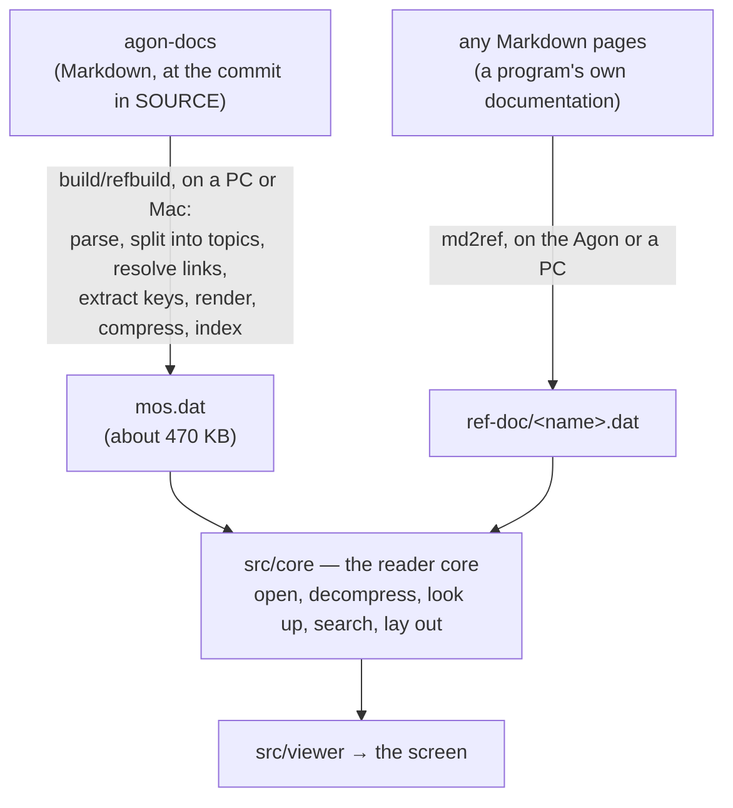
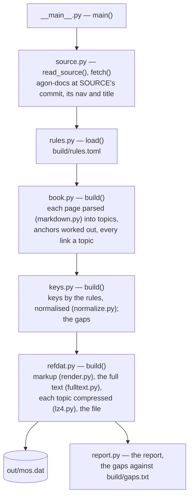
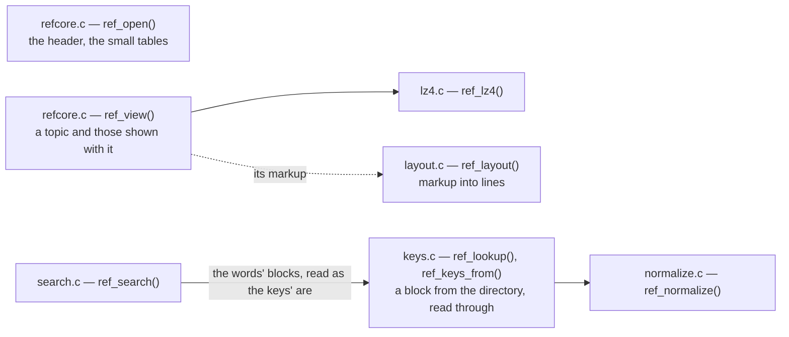
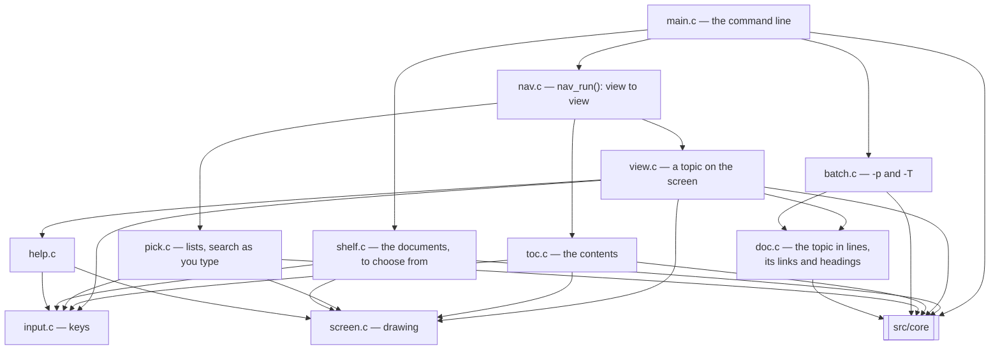
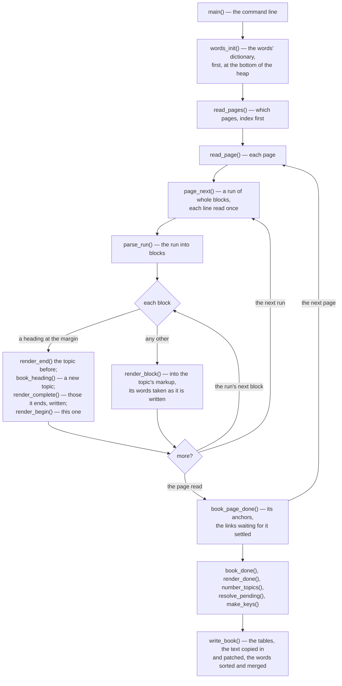
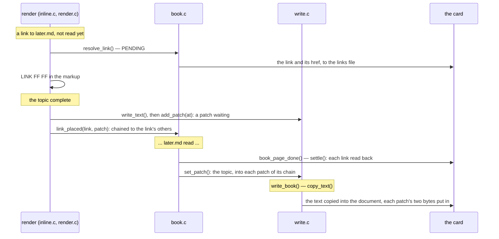
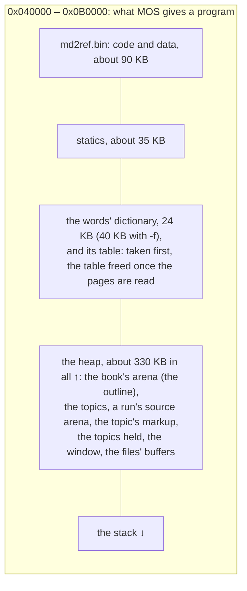

# How ref works

ref reads documents: one file each, in the format specified in
[FORMAT.md](FORMAT.md), installed as `/config/ref/docs/<name>.dat`. ref has
two halves. A **builder**, in Python on a PC or Mac, compiles agon-docs
into one, `mos.dat`. A **viewer**, in C on the Agon, reads documents with
seeks and shows them. Between them is the format, and on the Agon side a
portable **reader core** that knows it. **md2ref**, in portable C, writes
the format from any Markdown, on the Agon or a PC, so a program can ship
its own documentation. Any other tool can write the format too.

The Agon has 512 KB and the wiki is 700 KB of text, so nothing is loaded
whole: a document is read a topic, a key block or a word block at a time.

## The builder

`python3 -m refbuild` ([`__main__.py`](../build/refbuild/__main__.py)) runs
these steps in order.

**The source.** [`source.py`](../build/refbuild/source.py) reads
[`SOURCE`](../SOURCE), fetches agon-docs at that commit once into
`build/cache`, and reads `mkdocs.yml`'s `nav` (the wiki's menu) and
`site_name` (its title).

**Parsing.** [`markdown.py`](../build/refbuild/markdown.py) parses each
page into a small document model: headings, paragraphs, lists, code,
tables, notes (admonitions), quotes and rules, with inline code, emphasis,
links and images. It covers the Markdown the wiki uses, which is
Python-Markdown's plus MkDocs' extensions. Every block keeps its line
number, so errors can say where they are.

**Topics and links.** [`book.py`](../build/refbuild/book.py) splits pages
into topics at headings. A topic holds only its own text, up to the next
heading of any level. Its descendants are numbered straight after it, so
"a heading and everything under it" is a topic and the topics that follow
it. Each topic records its parent and children, and the nav's sections,
pages and headings form the contents tree. Anchors are worked out as
Python-Markdown's table of contents makes them, and every internal link
becomes a topic number. A link that cannot be resolved stops the build,
naming its page and line; one the wiki itself gets wrong is fixed in
[`build/rules.toml`](../build/rules.toml), which says why.

**Keys.** [`keys.py`](../build/refbuild/keys.py) turns headings into
lookup keys using the rules in `rules.toml`, page by page. A rule can take
a VDU sequence from a heading, a star command from a heading's code, a
range of PLOT codes, or apply a regular expression to a heading, a code
block or the body text. Every heading also gives the words of its title.
A heading that no rule keys, on a page that isn't marked as prose, is a
*gap*. The known gaps are listed in [`build/gaps.txt`](../build/gaps.txt),
and a new one fails a test, so a page added to the wiki can't go
unindexed unnoticed.

**Normalising.** Keys and what the user types pass through the same
function, [`normalize.py`](../build/refbuild/normalize.py), whose
docstring is the specification. It lowercases, reads numbers in every form
MOS accepts and writes them in decimal (hex after `rst`), puts `vdu` in
front of a leading number, and applies *skips*. A skip turns the parameter
a command family names before its number into `_`: the buffer ID of
`VDU 23, 0, &A0` and the channel of `VDU 23, 0, &85`. That way
`VDU 23,0,&A0,1;6` and `vdu 23 0 160 1 0 6` both become
`vdu 23 0 160 _ 6`. Every key normalises to itself.

**Rendering.** [`render.py`](../build/refbuild/render.py) turns each topic
into ref's markup, a byte stream the viewer lays out at any width:

    block:   kind|flags  indent  hang  content...  END
    kinds:   PARA (wrapped), HEAD (a heading), PRE (code and tables, never
             wrapped), RULE
    flags:   SPACE (a blank line before), NOTE (drawn with a bar)
    inline:  EM on/off, CODE on/off, LINK lo hi ... LINK_END, BREAK

Control bytes are all below 0x20. The text is in the Agon's character set
(its system font is Windows-1252 above 0x7F, nearly), and anything the font
lacks is replaced. Tables are laid out here, as ruled columns 76 wide with
cells wrapped inside them, because a column's width needs the whole table.
A topic shown on its own, without descendants that would pass 16 KB, ends
with links to its children.

**Layout.** [`layout.py`](../build/refbuild/layout.py) lays markup out into
lines. The C must produce exactly the same lines, and the tests compare
them.

**Full text.** [`fulltext.py`](../build/refbuild/fulltext.py) indexes
every word of three letters or more, minus stop words, with the topics it
appears in and whether it is in their titles. It also holds the reference
search: topics are ranked by query words in their title, then by query
words they contain, then in book order.

**The file.** [`refdat.py`](../build/refbuild/refdat.py) compresses each
topic as an LZ4 block ([`lz4.py`](../build/refbuild/lz4.py)) whose matches
may reach into an 8 KB dictionary of strings common to many topics, and
writes the file. [FORMAT.md](FORMAT.md) specifies every byte; in short:

| Section | Holds |
|---|---|
| header | magic, version, the agon-docs commit and date, the wiki's title, every section's offset, the buffer sizes the viewer needs |
| nodes | the contents tree, in preorder |
| topics | each topic's title, compressed text, parent and span (how many topics after it are shown with it) |
| titles | every title once |
| text | each topic, compressed on its own |
| keys, key directory | the keys, sorted, front-coded in blocks of 64; every block's first key, kept in memory |
| words, word directory | the full-text index, laid out the same way |
| normalising settings | hex-after words, skips and stop words, so the viewer normalises exactly as the builder did |
| dictionary | the shared compression dictionary |

The build is deterministic: the same source gives the same bytes.
[`report.py`](../build/refbuild/report.py) writes `out/report.txt`, which
lists the contents, the keys, the gaps and the sizes.

## The reader core

[`src/core`](../src/core) is portable C (stdio, string and stdlib only),
and knows one document at a time.
It builds for the Agon with agondev and with acc, and on a PC for the
tests. [`refcore.h`](../src/core/refcore.h) is its API.

- [`refcore.c`](../src/core/refcore.c) opens a document. It reads the header,
  checks the sections fit together, and loads the small tables (topics,
  directories, settings, dictionary). It decompresses a topic and the
  topics shown with it into one view buffer with the LZ4 decoder in
  [`lz4.c`](../src/core/lz4.c), whose matches can reach back into the
  dictionary.
- [`normalize.c`](../src/core/normalize.c) is `normalize.py` in C, step for
  step, configured from the file's settings.
- [`keys.c`](../src/core/keys.c) does lookups: an exact key, else the
  longest key the query starts with (a whole token at a time, or a name up
  to its `$`), else every key that starts with the query. A binary search
  of the in-memory directory finds the block; a buffered reader scans it.
- [`search.c`](../src/core/search.c) is the full-text search, ranked as
  `fulltext.py` ranks.
- [`layout.c`](../src/core/layout.c) lays a topic out in one pass. Each
  line records the style and link open where it starts, so the viewer can
  draw any line on its own. Runs of plain text are crossed by two small
  leaf functions that the compiler keeps in registers, which is what makes
  the largest topic quick to show.

Buffers are allocated by `ref_open` and sized from the header. Large ones
are static or on the heap: agondev's stack frames are kept under 128 bytes,
which [`test/frames.sh`](../test/frames.sh) enforces.

## The viewer

[`src/viewer`](../src/viewer), built by agondev
([`agon.mk`](../agon.mk)). [`ui.h`](../src/viewer/ui.h) lists the parts.

- [`main.c`](../src/viewer/main.c) parses the command line: options
  anywhere, the first other word the document, the rest the query. It
  opens the document, looks the query up (searching if no key matches,
  unless `-k`) and then prints, times or shows. Plain `ref` browses
  instead. It returns 0 when something was shown and 100 when nothing
  was, never 1, 4 or 5, which MOS reports as errors of its own.
- [`shelf.c`](../src/viewer/shelf.c) finds the documents in the current
  directory and in `/config/ref/docs`, reading each directory entry by
  entry, with each document's title from its header, and shows them to
  choose from. A name in both is the current directory's; a `.dat` there
  counts only if it starts with the format's magic, as it could be any
  program's data. Esc
  from a document's contents, with no topic open, comes back here; the
  views are reset before the next document opens.
- [`nav.c`](../src/viewer/nav.c) moves between the views (a topic, the
  contents, a list, search) until the user quits. Each view returns where
  to go next.
- [`doc.c`](../src/viewer/doc.c) holds the topic laid out into lines and
  answers questions about it: the link at a position (with every line it
  wraps onto), a heading's extent, the next link or heading, and find. It
  knows nothing about the screen.
- [`view.c`](../src/viewer/view.c) is a topic on the screen: the cursor,
  what it lights, drawing, the keys and the history. The history holds the
  cursor's place, and also a mark for the view a topic was opened from, so
  Backspace goes back there. After a move it redraws as little as it can
  (see the screen below).
- [`toc.c`](../src/viewer/toc.c) is the contents tree,
  [`pick.c`](../src/viewer/pick.c) the lists and search-as-you-type,
  [`help.c`](../src/viewer/help.c) the help screen,
  [`batch.c`](../src/viewer/batch.c) `-p` and `-T`.
- [`input.c`](../src/viewer/input.c) reads key events from agondev's queue,
  each with the modifiers as they were when the key went down, and maps
  every spelling of a key to what it means.
- [`screen.c`](../src/viewer/screen.c) draws.

**The screen.** The top row is a header with the document's title, then the
text rows inside a margin each side, then a status line. Each row is drawn
whole and sent in one RST 18h call. Colours are chosen by role and mapped
for 16-, 4- and 2-colour modes.

- **The last column.** Nothing is ever printed in the last column, so the
  VDP never wraps or scrolls. The header and status line still reach it:
  that cell is painted as a one-cell text viewport cleared in the bar's
  colours (`VDU 28`, `VDU 12`, `VDU 26`).
- **Scrolling.** A move of up to three lines scrolls the text rows on the
  VDP, inside a viewport above the status line (`VDU 23,7`), and draws
  only the rows that came into view.
- **Colour between rows.** Each row starts in the text colour, so a row
  that ends lit doesn't light the next one's padding.

**The scripted build.** Built with `REF_SCRIPT`, ref reads its keys from
`/ref.keys` on the card and writes a transcript to `/ref.out`: what each
view did, screen dumps, the VDP's own screen read back, and cell colours.
That is all in [`script.c`](../src/viewer/script.c). The release build
reaches it only through two macros, `SCRIPTED(...)` and `LOG(...)`, which
compile to nothing there.

## md2ref

[`src/md2ref`](../src/md2ref) compiles Markdown pages into a document. It
is portable C, built for the PC by `make host` and for the Agon by
[`md2ref.mk`](../md2ref.mk), and gives the same bytes on both.
[`md2ref.h`](../src/md2ref/md2ref.h) lists its files. It reads each page
once, and writes each topic as soon as it can:

| Step | Where | What |
|---|---|---|
| pages | [`input.c`](../src/md2ref/input.c) | the files given, or a directory's `.md` files, index first; each read through a window a *run* at a time |
| blocks | [`parse.c`](../src/md2ref/parse.c) | a run's lines into blocks: headings, paragraphs, code, lists, quotes, notes, tables, one function each |
| outline | [`book.c`](../src/md2ref/book.c) | topics from headings as they come, anchors as Python-Markdown makes them, links resolved or left pending |
| markup | [`render.c`](../src/md2ref/render.c), [`inline.c`](../src/md2ref/inline.c) | each topic in ref's markup, tables laid out, its words taken as it is written, and held until its descendants are read |
| text | [`write.c`](../src/md2ref/write.c), [`lz4w.c`](../src/md2ref/lz4w.c) | each topic, complete, to the text's scratch file: stored as an LZ4 block of literals, or with `-z` compressed |
| indexes | [`index.c`](../src/md2ref/index.c) | keys from headings' code spans, VDU sequences and title words, normalised by the reader core's own [`normalize.c`](../src/core/normalize.c); each topic's names -- title, headings, code spans, links' labels, emphasis -- or with `-f` every word, to the words' scratch file |
| document | [`write.c`](../src/md2ref/write.c) | the tables from memory, the text copied in with each link patched, the words sorted and merged in |

**One pass, in fixed memory,** as aed, acc and zap work. The window holds
whole lines, 8 KB to start and up to 32 KB for a long block. A run ends
only where a block must: after a blank line, outside a code fence, before
a line at the margin that is not a list item. Every container ends there,
so the parser sees each run as it would the whole page. Each block is
rendered into its topic as soon as it is parsed, and a run's blocks, in a
*source* arena, go once it is rendered. What lasts goes in the *book's*
arena: titles, headings, anchors.

Three things are not known when a topic is read, and are settled the way
an assembler settles a forward reference:

- **A link to a page not read yet** is a placeholder, and the link is
  remembered with its target. Stored, those two bytes lie in the file as
  they do in the markup; with `-z` the compressor leaves them as literals,
  never matched or matched from, so they still do. When the document is put together, every anchor known,
  each is patched as the text is copied in.

- **Links to a topic's children** are added only if it shows too much with
  its descendants, which is only known once the last of them is read. So a
  topic is held until then. Only its ancestors are held with
  it, at most a few.
- **A page's top topic** is its level-1 heading if that is the page's
  first block and its only level-1 heading. The first is taken to be the
  only one until a second shows otherwise. Then the page's top, titled by
  its name, is made in front of the first, and the page's topics move up
  one. The words file and the links to children hold each topic's number
  *as made*, mapped to its place at the end, so what was already written
  needs no change.

The tables come before the text in the document but are only complete at
the end. So the text goes to a scratch file, and the document is written
front to back once everything is known, the header last, into the space
left for it. The words are never all in memory either. Each topic's
distinct words go to a second scratch file. At the end it is sorted in
16 KB runs into a third, and those are merged through a 512-byte window
each.

**Stored, not compressed,** unless `-z` asks: compressing took as long on
the Agon as all the rest of the work, to save card space that does not
matter there. A stored topic is an LZ4 block of literals alone, which ref
reads as it reads any, so the format is the same; the document is about
40% larger (827 KB for agon-docs, 587 KB with `-z`), and ref's buffer for
a packed topic as big as the largest topic.

All of agon-docs, 637 KB of Markdown and 721 topics, peaks at about
218 KB on the Agon, 273 KB with `-f` (`make agon-md2ref-heap` measures it, and
`test/md2ref.sh` holds it to a budget). What grows with a document is its
outline: its topics, their titles and anchors, and its keys. The heap is
333 KB, and agondev's allocator never gives back part of a block -- realloc
makes a block bigger by copying it, and smaller not at all -- so what is
big is taken once, early: the words' dictionary, a fixed 24 KB at the
bottom of the heap (40 KB with `-f`), with its table freed once the pages
are read.
Grown a piece at a time, as it was, it left no room for a large topic.

It ends with "Done in N.NN seconds", worded as zap and acc word it, from
MOS's clock. Under an emulator running flat out that clock means nothing,
so `make agon-md2ref-cycles` builds one that has the emulator count its
cycles instead (IO ports 0x40 and 0x41, fab-agon-emulator 2037657 on), as
acc's bench does. All of agon-docs takes 381 million cycles: 21 seconds
at the Agon's 18.432 MHz (594 million with `-f`). That is a lower bound. The count is exact for
the eZ80's own work, but the emulator charges nothing for reading the SD
card, and md2ref reads its pages and three scratch files. The ports are
written around the work alone, so loading and MOS's start-up are not
counted. Counts compare only under the same MOS: test/emu.sh boots 3.0.2.
`test/md2ref.sh` reports the figure, and fails when the emulator gives
no count.

**Two loops by hand.** Nearly every byte passes through two loops that
agondev's clang compiles poorly, spilling every pointer to the frame:
copying text into markup, and (with `-z`) LZ4's search for a match.
Those two are in eZ80 assembly on the Agon, beside the C the PC runs:
[`copytext.s`](../src/md2ref/copytext.s), for inline.c's copy_text, and
[`lz4scan.s`](../src/md2ref/lz4scan.s). They do exactly what the C does,
and `test/md2ref.sh` holds what the Agon writes to what the PC does, byte
for byte -- agon-docs, and a page of the copy's edge cases.

**Not the builder.** md2ref has no rules file: no hand-made keys, no link
fixes, no gaps report, no shared dictionary. Its keys are what headings
say. The builder stays the way agon-docs is made.

## Testing

- `make test` runs the builder's tests ([`build/tests`](../build/tests)):
  the parser, the topic model, keys, normalising, rendering, layout, LZ4
  and the file. It includes a test over the whole wiki that every link
  resolves, 70-odd lookups reach their topics, and the build is
  reproducible. It then builds the core for the PC
  ([`test/host/reftool.c`](../test/host/reftool.c)) with the address and
  undefined-behaviour sanitisers, and holds it against the builder: every
  key, hundreds of lookups and searches, every topic byte for byte, and
  every layout line for line at two widths. Normalising cases shared by
  both sides are in
  [`build/tests/normalize.json`](../build/tests/normalize.json).
- `make emu` ([`test/run.sh`](../test/run.sh)) runs ref in
  fab-agon-emulator on MOS 3.0.2, driven as the harness in
  [`test/emu.sh`](../test/emu.sh) describes. The command goes in
  `autoexec.txt` and stdin is held open by a fifo, never typed into. The
  checks cover the release build's printing and exit codes, every view
  through the scripted build, ade's F1 under hub through a stand-in client
  ([`test/agon/hubf1`](../test/agon/hubf1)), the screen read back from the
  real VDP on the full emulator in three modes, the heap's peak (measured
  with zap's zmalloc shim), and the timings, taken from MOS's own clock.
- [`test/core.sh`](../test/core.sh) builds the PC test tool for the Agon
  with agondev and with acc. It runs every mode in the emulator and
  requires the same answers as the PC, byte for byte.
- `make test` also runs md2ref's tests
  ([`build/tests/test_md2ref.py`](../build/tests/test_md2ref.py)), on a
  small document ([`build/tests/md2ref`](../build/tests/md2ref)) read back
  through the reader core, its errors, and all of agon-docs under the
  sanitisers. [`test/md2ref.sh`](../test/md2ref.sh) runs md2ref in the
  emulator: the documents it writes there must be the PC's byte for byte,
  ref must list and read them, and 105 KB of agon-docs must fit.

Every check has been confirmed to fail when the line it covers is broken.

## Things to know

- **A compiler bug.** agondev's clang 15.0.7 can compile `n = *p++` so
  that the load happens after the increment. [`agon.mk`](../agon.mk)
  builds with `-mllvm -twoaddr-reschedule=false`, which avoids it.
  `test/core.sh` catches it if it returns.
- **Two programs, one tree.** agondev's makefile takes every `.c` under
  `src` as a program's objects, and reads them before agon.mk or md2ref.mk
  can narrow them. The [`Makefile`](../Makefile) gives each its `OBJS` on
  the command line instead.
- **`unsigned` is 24 bits** on the eZ80. md2ref's LZ4 hash shifts its
  32-bit product before narrowing it; narrowed first, the Agon's output
  differed from the PC's, which `test/md2ref.sh` caught.
- **Memory.** About 40 KB of code and 75 KB of statics, and a heap that
  peaks at about 85 KB (`make agon-heap` measures it): well inside the
  448 KB a program has.
- **Speed**, in the emulator at the Agon's own speed: a lookup takes
  6-14 ms, a search about 40 ms, and opening the largest topic (24 KB of
  tables) under 200 ms. `ref -T` measures them on the machine.
- **The license.** agon-docs has none yet, so mos.dat can't be published.
  [`mkrelease.sh`](../mkrelease.sh) refuses to build a release until
  `REF_LICENSE_SETTLED=1` says the license is settled.
